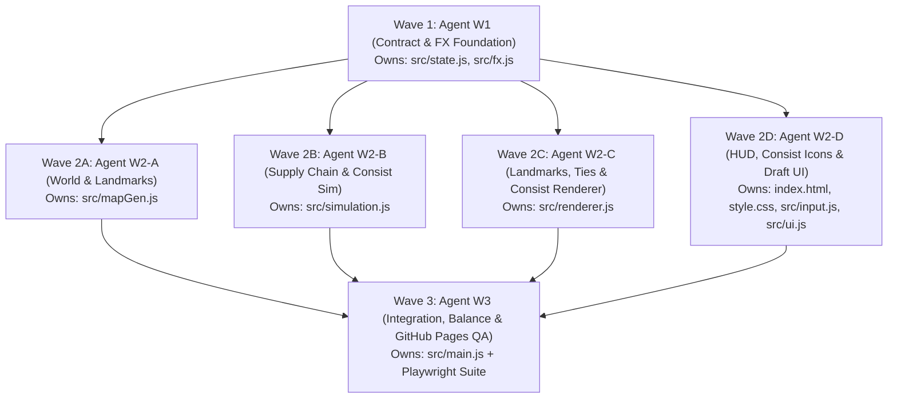

# Mini Rail v2 — Hydrogen Multi-Agent Execution Plan

## 1. Mission & Design Goals

Transform **Mini Rail** from an abstract *Mini Metro*-style shape matcher into a distinctive, fluid, immediately legible **Regional Railway & Supply-Chain Strategy Game**:

1. **Unmistakable Regional Identity (Supply Chains + Growing Settlements)**:
   - Replace abstract geometric shapes (`■ ● ▲ ◆`) with illustrated **Resource Sites** (Forests & Mines), **Factories** (converting Raw Materials into Manufactured Goods), and named **Settlements** (`Hamlet → Town → City`) that physically sprout new buildings, expand capacity, and award bonus upgrades as you supply them with Goods.
   - Replace polygon passenger matching with **Commuters** (Town → any City), **Local Travelers** (City → any Town), and **Intercity Tickets** stamped with a target City's crest color and 2-letter station code (e.g., `GH`, `NP`).
2. **Understandable in 2 Seconds at a Glance**:
   - Start every new game with **1 live pre-built Town ↔ City Express line already running** so players immediately see a 3-unit passenger train gliding between named settlements on page load.
   - Draw clear architectural silhouettes, settlement nameplates + Goods growth bars (`📦 0/4`), Factory `[Raw → Goods]` recipe badges, and an animated **Freight Onboarding Guide** (`Connect Timber Camp → Millworks → Grandhaven`) until the player builds their first industrial line.
   - **Auto-dispatch** an idle matching locomotive from the dock whenever a player draws a brand-new line (while preserving manual drag-and-drop to add/move trains and carriages).
3. **Articulated Multi-Carriage Trains & Fluid Living World**:
   - Keep crisp **45° octilinear tracks** (upgraded with smoother `28px` corner fillets and subtle wooden railway sleepers/ties).
   - Spawn **every locomotive with 2 coupled carriages by default** (`Express` = sleek passenger loco + 2 coaches; `Freight` = heavy loco + 2 open cargo wagons), upgradable up to `4` carriages (`3` capacity per carriage = `6` base, `12` max). Every carriage tracks the train's exact cumulative path history so the whole consist snakes around corners and lane switches.
   - Add smooth train acceleration/braking curves, locomotive exhaust puffs (heavier on hills), puffing Factory chimney smoke, arcing hop animations when passengers/crates board or deliver, animated river current ripples, and settlement level-up building pops.

### Tech & Deployment Constraints
- **Zero external dependencies & zero build step**: Vanilla HTML5 Canvas, CSS3, and ES6 modules (`index.html`, `style.css`, `src/*.js`) served statically.
- **Git & Hosting Policy**: Push directly to `main` on `https://github.com/piezoperny/minirail` (do **not** open pull requests unless explicitly requested). Pushing to `main` automatically deploys live to GitHub Pages at `https://piezoperny.github.io/minirail/`.

---

## 2. Parallel Execution Topology & Strict File Ownership

To prevent merge conflicts across concurrent Hydrogen agents, execution is divided into **3 Dependency Waves** with strict single-owner file boundaries in Wave 2:



| Wave | Agent Role | Owned Files (Exclusive Write Access) | Read Dependencies |
| :--- | :--- | :--- | :--- |
| **Wave 1** | **W1: Contract & FX Architect** | `src/state.js`, `src/fx.js` *(new)* | Existing `src/state.js` |
| **Wave 2** | **W2-A: World & Landmarks** | `src/mapGen.js` | `src/state.js` |
| **Wave 2** | **W2-B: Simulation & Consists** | `src/simulation.js` | `src/state.js`, `src/fx.js`, `src/mapGen.js` (existing exports) |
| **Wave 2** | **W2-C: Fluid Canvas Renderer** | `src/renderer.js` | `src/state.js`, `src/fx.js`, `src/mapGen.js` (existing exports) |
| **Wave 2** | **W2-D: UI, Input & Audio** | `index.html`, `style.css`, `src/input.js`, `src/ui.js` | `src/state.js`, `src/simulation.js` (stable exported signatures) |
| **Wave 3** | **W3: Lead Integrator & QA** | `src/main.js` + verification suite | All modules |

---

## 3. Shared Data Contracts (Locked in Wave 1)

All Wave 2 agents MUST code against these exact data shapes in `src/state.js` and `src/fx.js`.

### 3.1 `CONFIG` Additions & Updates (`src/state.js`)
- `FILLET_RADIUS: 28` (smoother 45° railway bends).
- `TRAIN_DEFAULT_CARS: 2`, `MAX_CARS_PER_TRAIN: 4`, `CAR_CAPACITY: 3` (total train capacity = `train.cars * CONFIG.CAR_CAPACITY`, so `6` default up to `12` max; locomotive pulls the consist and holds `0` cargo itself).
- `CAR_SPACING: 26` (world-unit arc spacing between loco and each coupled carriage).
- `TRAIN_ACCEL: 220`, `TRAIN_DECEL: 290` (world units / $\text{s}^2$ for smooth start/stop).
- `FACTORY_PROCESS_TIME: 3.5`, `FACTORY_INPUT_MAX: 6`.
- `SETTLEMENT_TIERS`:
  - Tier 1 (`Hamlet`): `capacity: 6`, `goodsTarget: 4`
  - Tier 2 (`Town`): `capacity: 8`, `goodsTarget: 6`
  - Tier 3 (`City`): `capacity: 10`, `goodsTarget: null` (continues consuming Goods for `+2` bonus score per crate)
- `CITY_CREST_PALETTE`: `['#B83280', '#2B6CB0', '#2F855A', '#C05621', '#6B46C1', '#0987A0']`
- `SETTLEMENT_NAMES`: Pool of regional names with 2-letter codes, e.g.:
  `[['Grandhaven', 'GH'], ['Oakridge', 'OK'], ['Millbrook', 'MB'], ['Northport', 'NP'], ['Ashford', 'AF'], ['Riverbend', 'RB'], ['Eastwick', 'EW'], ['Pinehurst', 'PH'], ['Stonebridge', 'SB'], ['Fairview', 'FV'], ['Clearwater', 'CW'], ['Highgate', 'HG']]`
- `INDUSTRY_NAMES`:
  - `forest`: `['Timber Camp', 'Pine Logging', 'Cedar Woods', 'Redwood Mill']`
  - `mine`: `['Iron Ridge', 'Coal Hollow', 'Copper Quarry', 'Granite Pit']`
  - `factory`: `['Millworks', 'Valley Foundry', 'Steam Joinery', 'Ironworks']`
- Starter Inventory (`createInitialState`):
  - `unlockedLines: 3` (Line 0 pre-built on load, leaving 2 open lines immediately available).
  - `inventory`: `{ express: 1, freight: 1, car: 1, bridge: 2, doubleTrack: 1, tunnel: 1 }` (note: `initStarterLine` will deploy `1` Express onto Line 0 at startup so `0` Express and `1` Freight remain ready in the dock, plus `1` Extra Carriage so the player can immediately test adding a 3rd car!).

### 3.2 Station Schema (`state.stations[]`)
```js
{
  id: number,
  x: number,
  y: number,
  kind: 'settlement' | 'resource' | 'factory',
  subtype: 'hamlet' | 'town' | 'city' | 'forest' | 'mine' | 'factory',
  name: string,              // e.g. 'Grandhaven', 'Oakridge', 'Timber Camp', 'Millworks'
  tier: 1 | 2 | 3,           // used when kind === 'settlement' (1=Hamlet, 2=Town, 3=City)
  cityCode: string | null,   // e.g. 'GH' when tier === 3
  crestColor: string | null, // hex from CITY_CREST_PALETTE when tier === 3
  goodsProgress: number,     // Goods delivered toward next tier
  goodsTarget: number | null,// 4 for tier 1, 6 for tier 2, null for tier 3
  buildingSeeds: Array<{ dx: number, dy: number, w: number, h: number, roof: number }>,
  inputBuffer: number,       // used when kind === 'factory' (0..6 Raw Materials stored)
  processProgress: number,   // used when kind === 'factory' (0..1 conversion progress)
  capacity: number,          // waiting platform limit (6 resource/hamlet, 8 factory/town, 10 city)
  queue: Array<Token>,       // waiting outbound passengers or cargo
  overflowTimer: number,     // 0..30s
  spawnTimer: number,
  pulse: number,             // 1->0 pop animation on spawn or level-up
  hoverScale: number,        // spring-animated scale (default 1.0)
  hoverVel: number,          // spring velocity
}
```

### 3.3 Waiting / Carried Token Schema (`Token`)
```js
{
  id: number,
  kind: 'commuter' | 'local' | 'intercity' | 'raw' | 'goods',
  service: 'express' | 'freight', // 'express' for commuter/local/intercity; 'freight' for raw/goods
  targetCityId: number | null,    // set only when kind === 'intercity'
  cityCode: string | null,        // e.g. 'NP' when kind === 'intercity'
  crestColor: string | null,      // hex when kind === 'intercity'
  spawnedAt: number,
}
```

### 3.4 Articulated Train Schema (`state.trains[]`)
```js
{
  id: number,
  type: 'express' | 'freight',
  lineId: number,
  cars: number,              // starts at CONFIG.TRAIN_DEFAULT_CARS (2), max 4
  cargo: Array<Token>,       // max length = cars * CONFIG.CAR_CAPACITY
  state: 'atStation' | 'waitingBlock' | 'traversing',
  stationIndex: number,
  direction: 1 | -1,
  dwellTimer: number,
  exchangedAtStop: boolean,
  corridorKey: string | null,
  corridorDir: 'AtoB' | 'BtoA',
  fromStationId: number | null,
  toStationId: number | null,
  s: number,
  currentSpeed: number,      // smoothly accelerated/decelerated speed (u/s)
  totalTraveled: number,     // monotonic distance counter for carriage articulation
  pathHistory: Array<{ dist: number, x: number, y: number, angle: number }>,
  exhaustTimer: number,
  lane: 0 | 1,
  lateralOffset: number,
  x: number,
  y: number,
  angle: number,
}
```
`src/state.js` MUST export `recordTrainHistory(train, x, y, angle, stepDist)` and `sampleTrainCarriagePose(train, backDistance)` so both `simulation.js` and `renderer.js` share deterministic carriage positioning (initializing initial carriages cleanly trailed behind the locomotive along the starting tangent before movement begins).

### 3.5 Scoring & Onboarding Fields on `state`
Add to `createInitialState`:
- `deliveriesGoods: 0`
- `citiesGrown: 0`
- `nextTokenId: 1`
- `onboarding`: `{ freightLineBuilt: false, starterIds: { cityId: 1, townId: 2, resourceId: 3, factoryId: 4 } }`
- `fx`: `createFXState()` (from `src/fx.js`)

### 3.6 FX Module Contract (`src/fx.js`)
Export pure, zero-dependency Canvas 2D particle & micro-animation helpers:
- `createFXState()` → `{ puffs: [], hops: [], floaters: [], ripplesOffset: 0 }`
- `spawnPuff(state, x, y, opts)` — rising/expanding soft circle for train exhaust & factory smoke (`color`, `startR`, `endR`, `vx`, `vy`, `life`).
- `spawnTokenHop(state, fromX, fromY, toX, toY, tokenKind, color)` — `0.28s` parabolic hop arc when boarding or delivering.
- `spawnFloatingToast(state, x, y, text, color)` — rising world-space callout (e.g., `+1 Goods`, `TOWN GROWN! +1 TUNNEL`).
- `stepFX(state, dt)` — advances all particles, hops, river ripple phase, and station hover springs (runs on real `dt` even while paused, scaling smoke/ripples appropriately).

---

## 4. Detailed Wave Specifications

### Wave 1 — Agent W1 (`src/state.js`, `src/fx.js`)
1. Implement `src/fx.js` with `createFXState`, `spawnPuff`, `spawnTokenHop`, `spawnFloatingToast`, and `stepFX` (capping active `puffs` at `180` for locked 60 FPS).
2. Upgrade `src/state.js` with all Section 3 constants, schemas, `recordTrainHistory`, and `sampleTrainCarriagePose`.
3. Gate check: `node --check src/state.js && node --check src/fx.js`.

---

### Wave 2A — Agent W2-A (`src/mapGen.js`)
Keep all existing exported geometry helper signatures (`segmentsIntersect`, `distanceToRiver`, `countRiverCrossings`, `isPointInHill`, `computePolylineLengths`, `samplePointAlongPolyline`, `computeHillIntervals`, `buildOctilinearPoints`, `generateWorld`, `spawnNextStation`, `updateTargetCameraZoom`) intact so other modules never break!

1. **Starter Valley Layout (`generateWorld`)**:
   - Guarantee 4 readable starter landmarks inside the initial `zoom = 1.0` viewport:
     - Station `1`: Starter **City** (`kind: 'settlement', subtype: 'city', tier: 3`, e.g., *Grandhaven* `GH`, `capacity: 10`).
     - Station `2`: Starter **Hamlet** (`kind: 'settlement', subtype: 'hamlet', tier: 1`, e.g., *Oakridge*, `capacity: 6`, `goodsTarget: 4`), placed on the **same side of the river** or within 1 clean hop (`200–310` units) of Station `1` so the pre-built starter Express line is clean and immediately legible!
     - Station `3`: Starter **Resource Site** (`kind: 'resource', subtype: 'forest'`, *Timber Camp*, `capacity: 6`).
     - Station `4`: Starter **Factory** (`kind: 'factory', subtype: 'factory'`, *Millworks*, `capacity: 8`), positioned naturally between *Timber Camp* and *Grandhaven / Oakridge* (with at least one river or hill interaction across the freight corridor to showcase bridges/hills).
   - Record `{ cityId: 1, townId: 2, resourceId: 3, factoryId: 4 }` in `state.onboarding.starterIds`.
2. **Architectural Footprints (`buildingSeeds`)**:
   - Pre-generate deterministic little building offsets (`dx, dy, w, h, roof`) for every settlement (`3` buildings used at Tier 1, `6` at Tier 2, `10` at Tier 3) positioned around the station track pad without overlapping `STATION_RADIUS`.
3. **Progressive 18-Node Regional Expansion Schedule**:
   - Balanced sequence of new `hamlet` settlements, `resource` sites (`forest` & `mine`), `factory` hubs, and 1 mid-game `city` (*Northport* `NP` around spawn #5 so Intercity Tickets kick in smoothly even before the player levels up a Town to Tier 3!).

---

### Wave 2B — Agent W2-B (`src/simulation.js`)
Keep all existing exported function names (`getOrCreateCorridor`, `getLineEdges`, `lineHasEdge`, `canAddCorridorForLine`, `extendOrStartLine`, `insertStationIntoLine`, `trimLineEnd`, `removeSegmentFromLine`, `deployTrainOnLine`, `attachCarToTrain`, `reclaimTrainToInventory`, `moveTrainToLine`, `applyCorridorUpgrade`, `reclaimCorridorUpgrade`, `stepSimulation`) plus add `export function initStarterLine(state)`.

1. **Pre-Built Starter Line (`initStarterLine(state)`)**:
   - Connects `starterIds.townId` ↔ `starterIds.cityId` on Line `0` and calls `deployTrainOnLine(state, 'express', 0, townId)`, seeding `2` commuters at the Hamlet and `1` local traveler at the City so trains board and move within the first second of opening the page!
2. **Auto-Dispatch on New Line Creation (`extendOrStartLine`)**:
   - When `line.stations` transitions from empty (`0`) to `2` stations:
     - Mark `state.onboarding.freightLineBuilt = true` if either endpoint is `'resource'` or `'factory'`.
     - Inspect endpoint kinds: prefer `'freight'` if either station is `'resource'` or `'factory'`, else prefer `'express'`.
     - If `state.inventory[preferred] > 0`, automatically call `deployTrainOnLine(state, preferred, lineId, fromId)` and emit `spawnFloatingToast` (`Express Dispatched!` / `Freight Dispatched!`).
3. **Supply-Chain & Settlement Growth Simulation**:
   - **Resource Sites**: Spawn `kind: 'raw'` (`service: 'freight'`) tokens into `st.queue`.
   - **Factories**:
     - Unloading `'raw'` cargo increments `st.inputBuffer` (up to `FACTORY_INPUT_MAX`, plus `+1` delivery score & `spawnTokenHop`).
     - When `st.inputBuffer > 0` and `st.queue.length < st.capacity`, advance `st.processProgress += simDt / CONFIG.FACTORY_PROCESS_TIME`, emitting periodic `spawnPuff` chimney smoke. On completion (`>= 1`), decrement `inputBuffer`, reset `processProgress`, and push a `kind: 'goods'` (`service: 'freight'`) token into `st.queue`!
   - **Settlements**:
     - Unloading `'goods'` at any `settlement` scores `+2` (`deliveriesTotal`, `deliveriesCargo`, `deliveriesGoods`) and increments `st.goodsProgress`.
     - **Level-Up (`tier 1 → 2` at `4` Goods; `tier 2 → 3` at `6` Goods)**:
       - Increment `st.tier`, update `st.subtype` (`'town'` or `'city'`), increase `st.capacity` (`8` or `10`), set `st.pulse = 1.2`, increment `state.citiesGrown`.
       - When reaching `tier === 3`, assign unique `cityCode` and `crestColor` from `CONFIG`.
       - Grant `+1` bonus infrastructure upgrade (`doubleTrack`, `tunnel`, `bridge`, or `car`) directly to `state.inventory`, trigger `hooks?.onCityGrow?.(st)`, and `spawnFloatingToast(state, st.x, st.y, `${st.name} grew into a ${st.tier === 3 ? 'City' : 'Town'}! +1 ${bonusLabel}`, '#2F855A')`.
   - **Passenger Spawning**:
     - `tier < 3` Settlements spawn `'commuter'` tokens (wanting any `tier === 3` City).
     - `tier === 3` Cities spawn `'local'` tokens (wanting any `tier < 3` Settlement) and, whenever `>= 2` Cities exist on the map, `50%` of spawns are `'intercity'` tokens stamped with another active City's `id`, `cityCode`, and `crestColor`!
4. **Target Matching & Service-Segregated BFS (`tokenMatchesStation` + `findBfsFirstLines`)**:
   - `'commuter'` → `st.kind === 'settlement' && st.tier === 3`
   - `'local'` → `st.kind === 'settlement' && st.tier < 3`
   - `'intercity'` → `st.id === tok.targetCityId`
   - `'raw'` → `st.kind === 'factory' && st.inputBuffer < CONFIG.FACTORY_INPUT_MAX` (or any `'factory'` if en route)
   - `'goods'` → `st.kind === 'settlement'` (BFS naturally routes to the nearest connected Settlement; if multiple are equidistant, prefer `tier < 3` growing towns!).
5. **Smooth Kinematics & Articulated `pathHistory`**:
   - Replace instantaneous speed jumps with smooth `tr.currentSpeed` acceleration (`TRAIN_ACCEL`) and braking (`TRAIN_DECEL`), including smooth deceleration over the last `45` units when approaching a terminus or a station with matching unload/pickup or a red block signal!
   - Call `recordTrainHistory(tr, tr.x, tr.y, tr.angle, deltaS)` every step and emit subtle `spawnPuff` exhaust particles along the locomotive stack (faster & darker when climbing untunneled hills).

---

### Wave 2C — Agent W2-C (`src/renderer.js`)
Keep `export function renderGame(ctx, state)` (and `drawShape` if needed as a legacy helper).

1. **Animated River & Railway Track Ties**:
   - Add drifting translucent white current dashes along `state.river.points` driven by `state.fx.ripplesOffset`.
   - Render subtle perpendicular wooden cross-ties/sleepers (`setLineDash([2, 8])`) underneath every active octilinear corridor so tracks immediately read as regional rails rather than subway lines.
2. **Illustrated Landmarks, Nameplates & Recipe Badges**:
   - **Settlements**: Render small architectural roof/building clusters from `st.buildingSeeds.slice(0, tierCount)` softly framing the station pad, central crisp station hub (accented with `st.crestColor` & `st.cityCode` badge for Tier 3 Cities), bottom nameplate pill (`Oakridge`), and compact Goods progress pips (`▪▪▫▫` for `goodsProgress / goodsTarget`)!
   - **Resource Sites**: Render stylized pine trio (`forest`) or twin mountain/pickaxe silhouette (`mine`) + nameplate (`Timber Camp`).
   - **Factories**: Render sawtooth industrial roof + twin smokestacks, animated radial/bar progress on the roof while `processProgress > 0`, `inputBuffer` raw-material pips, and a crisp `[🪵 ➔ 📦]` recipe tag below!
   - **Readable Waiting Queue Icons**:
     - `'commuter'`: Clean person silhouette + dark city dot.
     - `'local'`: Clean person silhouette + warm cottage dot.
     - `'intercity'`: Rounded colored ticket pill in `tok.crestColor` with crisp white `tok.cityCode` text (`GH`, `NP`).
     - `'raw'`: Warm rust/amber raw-material log/ingot icon.
     - `'goods'`: Crisp stenciled crate box (`#2B6CB0` / `#5D473A` banded crate).
3. **Articulated Multi-Carriage Consists (`drawTrains`)**:
   - Draw coupler bars between the locomotive and each of its `1..tr.cars` carriages using `sampleTrainCarriagePose(tr, c * CONFIG.CAR_SPACING)`.
   - **Express Consist**: Streamlined tapered locomotive + line-colored passenger coaches with illuminated window bays that visibly fill as passengers board (`3` slots per coach).
   - **Freight Consist**: Heavy cab-forward/hood diesel locomotive + open-top flatbed/hopper wagons where carried `'raw'` logs/ore and `'goods'` crates sit visibly stacked inside each wagon!
4. **Freight Onboarding Ghost Guide & FX Layer**:
   - While `!state.onboarding.freightLineBuilt && state.week === 1`, draw a gentle animated dashed guide path from `resource → factory → city` with a floating pill: `"Drag from Timber Camp → Millworks → Grandhaven to start Freight!"`.
   - Render `state.fx.puffs`, parabolic `state.fx.hops`, and `state.fx.floaters` cleanly above stations/trains.

---

### Wave 2D — Agent W2-D (`index.html`, `style.css`, `src/input.js`, `src/ui.js`)
1. **Bottom Dock & HUD Clarity (`index.html`, `style.css`, `src/ui.js`)**:
   - Update `EXPRESS` and `FREIGHT` dock SVG icons so they visibly show a **locomotive + coupled carriage**, and rename `CAR` label to `+CARRIAGE` (`+3 capacity carriage, up to 4 per train`).
   - Add a `CITIES` / `GOODS` stat or tooltip clarity in the top HUD and update the **Game Over** summary cards to showcase: `Days Survived`, `Total Deliveries`, `Goods Supplied`, and `Towns Grown`.
   - Update the `?` Field Manual modal and Weekly Draft descriptions to explain the **Resource → Factory → Growing Town/City** loop and `+2 Extra Carriages` (`+3` cap each).
2. **Input & Hit-Testing (`src/input.js`)**:
   - Expand `hitTestTrain` to also hit-test coupled carriages (`sampleTrainCarriagePose`) so dragging `+CARRIAGE` onto *any* car of a moving train attaches cleanly!
   - Update station hover tracking so `st.hoverTarget` triggers the smooth spring scale in `stepFX`.
3. **Procedural Web Audio Polish (`src/ui.js`)**:
   - Add `onCityGrow()` triumphant warm major-chord arpeggio in `ui.hooks` alongside `onDelivery`, `onStationSpawn`, `onWeekEnd`, and `onGameOver`.

---

### Wave 3 — Agent W3 (`src/main.js` + End-to-End Verification & GitHub Pages Deploy)
1. **Bootstrap & Frame Driver (`src/main.js`)**:
   - Call `initStarterLine(state)` immediately after `generateWorld(state)` on initial load and on `onRestart`.
   - Call `stepFX(state, FIXED_DT)` inside the fixed-step loop so ambient animations, hover springs, and floating toasts stay silky even when simulation speed is `0` (paused).
2. **Automated Verification Suite**:
   - Run `for f in src/*.js; do node --check "$f"; done`.
   - Run a headless Playwright test verifying:
     1. **Immediate Readability on Load**: `state.lines[0].stations.length === 2`, `state.trains.length === 1`, starter Express has `cars === 2` and non-empty `pathHistory`, and `onboarding.freightLineBuilt === false`.
     2. **Auto-Dispatch & Freight Chain**: Drawing a line `Resource → Factory → Hamlet` sets `freightLineBuilt === true`, auto-dispatches the idle Freight consist (`cars === 2`), converts `raw → goods` at the Factory (`processProgress` & smoke puffs), delivers `goods` to the Hamlet, and levels the Hamlet up to a **Town** (`tier === 2`, granting `+1` bonus upgrade!).
     3. **Articulated Carriages & Overtaking**: Attaching `+CARRIAGE` increases `cars` to `3`, `sampleTrainCarriagePose` returns distinct curved coordinates per car, single-track sidings prevent collisions, and double-track overtaking works cleanly.
     4. **Weekly Draft, Game Over & Visual Inspection**: Capture a high-DPI gameplay screenshot (`1280×800 @ 2x`) and inspect it visually to confirm crisp landmark silhouettes, nameplates, coupled carriages, railway sleepers, and zero overlapping labels or console/page errors.
3. **Direct Deployment to GitHub (`main` → GitHub Pages)**:
   - Commit all modified/new files directly to `main` and `git push origin main`.
   - Poll `gh api repos/piezoperny/minirail/pages --jq .status` until `"built"` and verify `https://piezoperny.github.io/minirail/` serves the updated v2 build cleanly.
