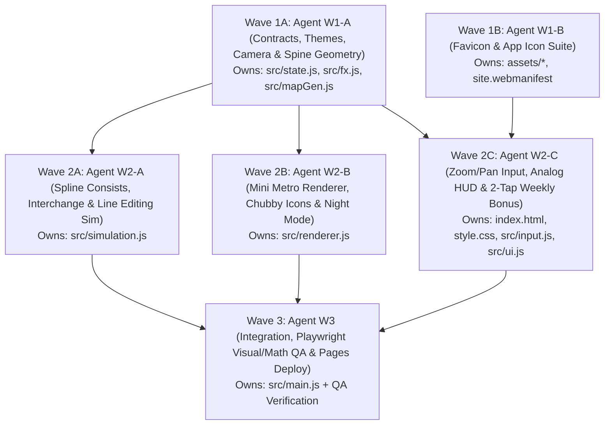

# Mini Rail v3 (First Overhaul) — Hydrogen Multi-Agent Execution Plan

## 1. Mission & Overhaul Goals

Transform **Mini Rail** into a crisp, tactile, bug-free **Mini Metro-inspired Regional Railway & Supply-Chain Strategy Game**, resolving all 8 player-reported issues from v2 playtesting plus 4 high-impact gameplay & UX upgrades:

1. **High-Fidelity Website & App Icon Suite (#1)**:
   - Ship a vector-crisp **Transit Junction Emblem on a Dark Ink Tile** (`#232629` rounded square with intersecting Vermilion `#D94E34`, Cobalt `#2B6CB0`, and Amber `#D69E2E` 45° transit lines meeting at a bold white interchange ring) across `assets/favicon.svg`, `assets/favicon-32.png`, `assets/apple-touch-icon.png` (`180×180`), `assets/icon-192.png`, `site.webmanifest`, and the HUD brand mark.
2. **Full Camera Zoom, Pan & Off-Screen Station Awareness (#2)**:
   - Add **cursor-anchored mouse-wheel & trackpad/touch pinch zoom (`0.45×` – `2.50×`)** plus **drag-empty-paper panning** (and middle-drag / `Space`+drag / two-finger touch pan).
   - Stop `stepSimulation` from hijacking `camera.zoom` once the player zooms or pans manually; add a **`Fit Map` (`F`)** HUD button and clickable **off-screen edge indicator pills** whenever a station spawns or overflows outside the current viewport.
3. **Exact Track-Spline Push-Pull Trains — Zero "Frozen Stick" or Circus Contortions (#3)**:
   - **Root causes eliminated**:
     - `recordTrainHistory` previously overwrote `last.dist = totalTraveled` whenever `stepDist < 2.0` (`100 u/s ÷ 60 fps = 1.67 u/frame`), preventing Freight `pathHistory` from *ever* recording a second point at `1×` speed and extruding carriages as a rigid straight stick off the track.
     - Reversing `180°` at termini over stale incoming `pathHistory` folded Express locomotives across their own coaches.
   - **Permanent fix**: Delete `pathHistory` completely. Build a deterministic **Continuous Line Spine (`buildLineSpine`)** per active line and position every unit of a consist by sampling **front & rear bogies** directly on the spine polyline. At line ends, consists perform a **Mini Metro push-pull reversal in-place** (flipping travel direction without teleporting, overshooting T-bars, or folding `180°`).
4. **Pure Mini Metro Visual Minimalism + Night Mode (#4 + Upgrade)**:
   - Strip away background grid lines, triple-dashed river current clutter, wooden railway sleeper ticks (`setLineDash([2, 8])`), scattered monopoly houses (`buildingSeeds`), `[Raw → Goods]` recipe pills, and always-on station nameplate pills.
   - Render bold geometric/iconic station nodes on a calm flat surface, hiding station text names until **hover or close zoom (`zoom >= 1.45`)**, with an instant **Daylight Paper / Charcoal Night Mode (`☀`/`☾` or `N`)** palette toggle.
5. **Chubby, Unmistakable Cargo & Passenger Icons (#5)**:
   - Enlarge waiting/carried token icons by ~60% (`14px` world footprint) with thick rounded strokes and contrast halos:
     - **Goods**: Plump rounded **Parcel Box** (warm ochre/amber crate with crisp tape cross-band — replacing the tiny blue `[x]` square).
     - **Raw Materials**: Plump rounded **Timber/Ingot Bundle** (warm terracotta cylinder with bright end-grain face).
     - **Passengers**: Plump rounded **Meeples** color-coded by destination (**Ink/White** = wants any City, **Warm Coral** = wants any Town/Hamlet, **City Crest Color** = wants that specific Tier-3 City — eliminating tiny `'GH'`/`'NP'` text pills).
6. **Smart Mini Metro Track Routing, Junctions & Water-Only Bridges (#6)**:
   - Render bridge kerbs/decks **strictly across river water intervals (`computeRiverIntervals`)**, never encasing dry land from station to station.
   - Align every line's **T-bar bumper** with the actual octilinear track exit tangent (`0° / 45° / 90°`) instead of the raw station-to-station vector.
   - Upgrade `buildOctilinearPoints` with **context-aware elbow scoring** (penalizing sharp V-hairpins at intermediate stations, avoiding slicing through unrelated stations, fanning out junction port angles) plus smooth corner fillets through intermediate stations on the same line.
7. **Crystal-Clear Station Queues & Rim Progress Rings (#7)**:
   - Move Hamlet/Town `goodsProgress` and Factory `processProgress` + `inputBuffer` onto clean **concentric arcs/ticks around the station rim**.
   - Dynamically place each station's waiting queue in its **clearest track-free sector** (scoring angles away from incident corridors and river banks) on a clean `18u` grid so tracks and houses never obscure waiting people or materials.
8. **Effortless 2-Tap Mini Metro End-of-Week Bonus (#8)**:
   - Replace the wordy 2-section form and disabled `Confirm &amp; Resume` button with an airy **Mini Metro Circular Badge Overlay**:
     - **Tap 1**: Click one of 2 large (`108px`) circular train badges (**Express** or **Freight**) — zero paragraph text.
     - **Tap 2**: Click one of 2 large (`108px`) circular upgrade badges (**New Line**, **+2 Carriages**, **+2 Bridges**, **Bridge + Tunnel**, **+2 Double-Track**, or **Interchange**) → pops into dock and **immediately resumes gameplay**.
9. **Additional Gameplay & UX Upgrades**:
   - **True Mini Metro Line Editing**: Bypass a single middle station cleanly (`A–B–C → A–C`) via right-click on station or dragging off-station instead of deleting half the line; hover any dock line pill to **spotlight** that route (dimming others); right-click a dock line pill to **clear &amp; reclaim** the entire route.
   - **Minimalist Analog-Clock HUD & Wordless Onboarding**: Replace the wide top stat strip and floating English tutorial sentence with a compact Mini Metro top-right cluster (**Analog Clock SVG + `MON–SUN` pill + Total Deliveries + Speed + Fit + Night Mode + Mute + `?`**) and a **wordless animated ghost-drag tutorial cue**.
   - **Interchange Hub Upgrade & Overcrowding Warning Pulse**: Add an **Interchange** upgrade (`+6` station capacity + `2.5×` faster boarding/unloading + bold outer hub ring) and unmistakable **rhythmic visual + audio overcrowding warning pulses** past 50% overflow timer.

### Tech & Deployment Constraints
- **Zero external runtime dependencies & zero build step**: Vanilla HTML5 Canvas, CSS3, SVG/PNG static assets, and ES6 modules (`index.html`, `style.css`, `src/*.js`) served directly on GitHub Pages.
- **Git & Hosting Policy**: Commit & push directly to `main` on `https://github.com/piezoperny/minirail` (do **not** open pull requests unless explicitly requested). Pushing to `main` deploys automatically to `https://piezoperny.github.io/minirail/`.

---

## 2. Parallel Execution Topology & Strict File Ownership

To guarantee zero merge conflicts and zero mismatched imports across concurrent Hydrogen agents, execution is structured into **3 Dependency Waves** with strict single-owner file boundaries:

| Wave | Agent Role | Exclusive Write Files | Read Dependencies |
| :--- | :--- | :--- | :--- |
| **Wave 1** | **W1-A: Core Contracts, Themes & Spine Geometry** | `src/state.js`, `src/fx.js`, `src/mapGen.js` | Existing `state.js`, `fx.js`, `mapGen.js` |
| **Wave 1** | **W1-B: Brand & Favicon Designer** | `assets/favicon.svg`, `assets/favicon-32.png`, `assets/apple-touch-icon.png`, `assets/icon-192.png`, `site.webmanifest` | `src/state.js` (palette hexes) |
| **Wave 2** | **W2-A: Simulation & Line Editing Engine** | `src/simulation.js` | Wave 1 `src/state.js`, `src/fx.js`, `src/mapGen.js` |
| **Wave 2** | **W2-B: Mini Metro Canvas Renderer** | `src/renderer.js` | Wave 1 `src/state.js`, `src/fx.js`, `src/mapGen.js` |
| **Wave 2** | **W2-C: Camera Input, HUD & Weekly Bonus UI** | `index.html`, `style.css`, `src/input.js`, `src/ui.js` | Wave 1 modules + `assets/*` + locked `simulation.js` exports |
| **Wave 3** | **W3: Lead Integrator, QA & Deployment** | `src/main.js` *(+ minor cross-module polish if needed during QA)* | All repository files |

---

## 3. Shared Data & Function Contracts (Locked in Wave 1)

All Wave 2 agents MUST program against these exact exports from `src/state.js`, `src/fx.js`, and `src/mapGen.js`.

### 3.1 `CONFIG`, Palettes & Camera Helpers (`src/state.js`)
- **Zoom & Consist Constants**:
  - `MIN_ZOOM: 0.45`, `MAX_ZOOM: 2.50`
  - `FILLET_RADIUS: 32`, `STATION_PASS_FILLET: 18`
  - `STATION_RADIUS: 16`, `T_BAR_OFFSET: 26`
  - `TRAIN_DEFAULT_CARS: 2`, `MAX_CARS_PER_TRAIN: 4`, `CAR_CAPACITY: 3`, `CAR_SPACING: 23`, `BOGIE_WHEELBASE: 13` (each consist has `unitCount = 1 + train.cars` total articulated units — `1` lead unit + `train.cars` coupled cars = `3` units default up to `5` max — with total cargo capacity = `train.cars * CONFIG.CAR_CAPACITY` = `6` default, `12` max).
  - `INTERCHANGE_CAPACITY_BONUS: 6`, `INTERCHANGE_DWELL_MULT: 0.4` (`2.5×` faster exchange).
  - `DAY_NAMES: ['MON', 'TUE', 'WED', 'THU', 'FRI', 'SAT', 'SUN']`.
- **Dual Theme Palettes (`THEMES` & `getThemePalette(state)`)**:
  - `THEMES.day`:
    - `bg: '#F4F1EA'`, `river: '#99BFCF'`, `riverHalo: '#DFEAF0'`, `hillFill: 'rgba(175, 163, 140, 0.14)'`, `hillStroke: 'rgba(140, 128, 108, 0.28)'`, `ink: '#232629'`, `stationFill: '#FFFDF9'`, `muted: '#6E6A61'`, `danger: '#D94E34'`, `bridgeStroke: '#7A7468'`, `bridgeDeck: '#F4F1EA'`, `queueHalo: 'rgba(244, 241, 234, 0.92)'`
    - `lineColors: ['#D94E34', '#2563EB', '#EAB308', '#16A34A', '#9333EA', '#0891B2']`
  - `THEMES.night`:
    - `bg: '#161A22'`, `river: '#0D1117'`, `riverHalo: '#1D2430'`, `hillFill: 'rgba(255, 255, 255, 0.035)'`, `hillStroke: 'rgba(255, 255, 255, 0.10)'`, `ink: '#F1F5F9'`, `stationFill: '#1E2430'`, `muted: '#94A3B8'`, `danger: '#F87171'`, `bridgeStroke: '#64748B'`, `bridgeDeck: '#161A22'`, `queueHalo: 'rgba(22, 26, 34, 0.92)'`
    - `lineColors: ['#FF5A3D', '#3B82F6', '#FACC15', '#22C55E', '#A855F7', '#06B6D4']`
  - Export `getThemePalette(state)` returning `THEMES[state.theme === 'night' ? 'night' : 'day']` and `getLineColor(state, lineId)`.
- **State Additions in `createInitialState(seed)`**:
  - `theme: 'day'` (`'day' | 'night'`)
  - `camera: { x: 0, y: 0, zoom: 1.0, targetX: 0, targetY: 0, targetZoom: 1.0, userControlled: false }`
  - `inventory: { express: 1, freight: 1, car: 1, bridge: 2, doubleTrack: 1, tunnel: 1, interchange: 0 }`
  - `interaction`: add `spotlightLineId: null`, `panStart: null` (`mode` supports `'pan'`).
  - Station fields: add `isInterchange: false`, `queueAngle: 0` (cached clearest sector angle in radians).
  - Train fields: replace `totalTraveled` / `pathHistory` with `consistStartU: 0`, `spineTotalLength: 0`, `unitPoses: []` (`Array<{ x, y, angle }>` for `0 .. train.cars`, index `0` = current travel-direction lead car so hit-testing & rendering are trivial!).
- **Camera Helper Exports (`src/state.js`)**:
  - `zoomCameraAtScreenPoint(state, screenX, screenY, zoomFactor)` — clamps `zoom` to `[CONFIG.MIN_ZOOM, CONFIG.MAX_ZOOM]`, adjusts `camera.x, camera.y` (and `targetX, targetY, targetZoom`) so the world point under `(screenX, screenY)` stays pinned, and sets `camera.userControlled = true`.
  - `panCameraByScreenDelta(state, dxScreen, dyScreen)` — shifts `camera.x -= dxScreen / scale`, `camera.y -= dyScreen / scale`, clamps to world bounds `[-1250..1250, -780..780]`, and sets `camera.userControlled = true`.
  - `resetCameraToFit(state)` — sets `camera.userControlled = false`, `camera.targetX = 0`, `camera.targetY = 0` (or bounding-box center of `state.stations`), and recomputes `targetZoom` to frame all active stations smoothly.

### 3.2 FX Module Updates (`src/fx.js`)
Keep existing `createFXState`, `spawnPuff`, `spawnTokenHop`, `spawnFloatingToast`, `stepFX` and add:
- `fx.pulses: []` and `fx.onboardingPhase: 0` (0..1 looping timer for the wordless ghost-drag tutorial).
- `spawnWarningPulse(state, x, y, maxR, color)` — expanding translucent danger ring for overcrowded stations (`life: 0.9s`).

### 3.3 Geometry, Water-Only Bridges & Continuous Line Spine (`src/mapGen.js`)
Keep all existing exports and add/upgrade:
1. **`computeRiverIntervals(points, cumLengths, totalLength, river)`**:
   - Samples along `points` every `4u` and returns merged `[{ start, end }]` arc-length spans where `distanceToRiver(river, pt.x, pt.y) <= river.halfWidth + 9`, clamped to `[CONFIG.STATION_RADIUS + 2, totalLength - CONFIG.STATION_RADIUS - 2]`.
2. **`extractSubPolyline(points, cumLengths, startS, endS)`**:
   - Returns exact `{ x, y }[]` sub-polyline between arc distances `startS` and `endS` (used by `renderer.js` to draw water-only bridges and hill-only tunnel bores!).
3. **Context-Aware `buildOctilinearPoints(ax, ay, bx, by, river, hills, context = null)`**:
   - Evaluates octilinear elbow candidates considering:
     - River crossings (`* 10000`) + hill length (`* 1.0`)
     - Unrelated station clearance (`context?.stations`, `+6500` penalty if polyline passes within `STATION_RADIUS + 14` of another station)
     - Smooth tangent continuation (`context?.inTangentAtA`, `context?.outTangentAtB`, penalizing `< 90°` sharp hairpins by `+4500`)
     - Hub octant spreading (`context?.usedAnglesAtA`, `context?.usedAnglesAtB`, `+900` penalty if within `22°` of another corridor's exit).
4. **Continuous Line Spine & Bogie Sampling**:
   - `buildLineSpine(state, line)` → returns `{ points, cumLengths, totalLength, stationU: number[], isLoop: boolean }`:
     - Builds the continuous ordered polyline across `line.stations` (`0 .. n-1`, plus closing leg `n-1 → 0` if `line.isLoop`), applying a smooth quadratic fillet (`CONFIG.STATION_PASS_FILLET = 18`) across intermediate stations where consecutive legs meet at `45°`–`135°` bends so routes curve gracefully through hubs!
   - `samplePoseOnSpine(spine, u, wheelbase = CONFIG.BOGIE_WHEELBASE, lateralOffset = 0)` → samples front bogie `u + wheelbase * 0.5` and rear bogie `u - wheelbase * 0.5` (clamping or wrapping on `isLoop`), returning `{ x, y, angle, tx, ty, nx, ny }`.
   - `computeTrainUnitPoses(spine, consistStartU, unitCount, direction, lateralOffset = 0)` → returns `unitPoses` ordered **front-to-back relative to `direction`** (`direction >= 0` leads with highest `u`; `direction < 0` leads with lowest `u`), guaranteeing **zero jump on push-pull reversal** and **100% curve adherence**!
5. **Octilinear T-Bar & Clearest Queue Sector Helpers**:
   - `getLineTBarPose(state, line, endSide)` → `{ x, y, ux, uy, px, py, stationId }` using the exact octilinear tangent of the spine at `u = 0` (`start`) or `u = totalLength` (`end`).
   - `computeStationQueueAngle(state, station)` → tests 8 octilinear angles (`0, π/4, ...`) around `station`, penalizing proximity to incident corridor tangents, river water, and viewport edges, returning the clearest unobstructed direction angle (preferring `0` East when clear).

### 3.4 Simulation Exports Locked for UI & Input (`src/simulation.js`)
Keep all existing exports (`initStarterLine`, `getOrCreateCorridor`, `getLineEdges`, `lineHasEdge`, `canAddCorridorForLine`, `extendOrStartLine`, `insertStationIntoLine`, `trimLineEnd`, `removeSegmentFromLine`, `deployTrainOnLine`, `attachCarToTrain`, `reclaimTrainToInventory`, `moveTrainToLine`, `applyCorridorUpgrade`, `reclaimCorridorUpgrade`, `stepSimulation`) and add:
- `removeStationFromLine(state, lineId, stationId)` — cleanly bypasses a single interior station (`A–B–C → A–C`) or trims an endpoint without destroying the rest of the line!
- `clearLine(state, lineId)` — removes all segments of `lineId`, reclaims all trains on `lineId` back to `state.inventory`, and releases unused corridors/upgrades.
- `applyStationUpgrade(state, stationId, upgradeType)` — handles `'interchange'` (`st.isInterchange = true`, `st.capacity += CONFIG.INTERCHANGE_CAPACITY_BONUS`, `st.pulse = 1.0`).

---

## 4. Detailed Wave Specifications

### Wave 1A — Agent W1-A (`src/state.js`, `src/fx.js`, `src/mapGen.js`)
1. Implement all Section 3.1 updates in `src/state.js` (remove buggy `recordTrainHistory`, keep a backwards-compatible shim for `sampleTrainCarriagePose(train, backDistance)` reading `train.unitPoses` if called, add `THEMES`, `getThemePalette`, `getLineColor`, and camera zoom/pan/fit helpers).
2. Implement Section 3.2 in `src/fx.js` (`pulses`, `onboardingPhase`, `spawnWarningPulse`).
3. Implement Section 3.3 in `src/mapGen.js`:
   - Remove `generateBuildingSeeds` clutter (set `buildingSeeds: []`).
   - Add `computeRiverIntervals`, `extractSubPolyline`, context-aware `buildOctilinearPoints`, `buildLineSpine`, `samplePoseOnSpine`, `computeTrainUnitPoses`, `getLineTBarPose`, and `computeStationQueueAngle`.
   - Update `updateTargetCameraZoom(state)` so it only updates `targetZoom` / `targetX` / `targetY` when `!state.camera.userControlled`.
4. Gate check: `node --check src/state.js && node --check src/fx.js && node --check src/mapGen.js`.

### Wave 1B — Agent W1-B (`assets/*`, `site.webmanifest`)
1. Design `assets/favicon.svg` (`64×64` viewBox):
   - Rounded squircle tile (`x="2" y="2" width="60" height="60" rx="14" fill="#232629"`).
   - Three crisp octilinear rail lines crossing cleanly:
     - Amber `#EAB308` diagonal-to-horizontal line (`stroke-width="6"`, `stroke-linecap="round"`, `stroke-linejoin="round"`).
     - Cobalt `#3B82F6` vertical-to-diagonal line (`stroke-width="6"`).
     - Vermilion `#FF5A3D` primary diagonal line (`stroke-width="6.5"`).
   - Central crisp white Mini Metro interchange station ring (`cx="32" cy="32" r="9.5" fill="#FFFDF9" stroke="#232629" stroke-width="3.5"`, inner dot `r="3.5" fill="#FF5A3D"`).
2. Generate high-DPI crisp PNG icons (`assets/favicon-32.png` `32×32`, `assets/apple-touch-icon.png` `180×180`, `assets/icon-192.png` `192×192`) directly from the exact vector geometry (using Python `Pillow`/`cairosvg` or headless Chromium canvas capture) and create `site.webmanifest`.

---

### Wave 2A — Agent W2-A (`src/simulation.js`)
1. **Spline-Bound Push-Pull Train Kinematics (`stepTrains`)**:
   - Cache/rebuild `line.spine = buildLineSpine(state, line)` whenever `line.stations` or corridors change (`markLineSpineDirty`).
   - Store `corridor.riverIntervals = computeRiverIntervals(...)` on every corridor in `getOrCreateCorridor`, passing `{ stations: state.stations, ... }` context to `buildOctilinearPoints` and refreshing `computeStationQueueAngle` on connected stations.
   - Track each train's position using `tr.s` on its active `corridor` mapped directly onto `line.spine` to compute `tr.consistStartU` (clamped to `[0, Math.max(0, spine.totalLength - span)]` on non-loop lines, wrapped modulo `spine.totalLength` on loops) and populate `tr.unitPoses = computeTrainUnitPoses(...)` every step (including at spawn in `deployTrainOnLine` and while stopped at stations!).
   - Set `tr.x = tr.unitPoses[0].x`, `tr.y = tr.unitPoses[0].y`, `tr.angle = tr.unitPoses[0].angle`.
   - **Push-Pull Terminus Reversal**: When arriving at `stationIndex === 0` or `stationIndex === line.stations.length - 1` on a non-loop line, keep `tr.consistStartU` anchored cleanly inside the line endpoints and flip `tr.direction` when departing — zero folding, zero stick overhang!
2. **True Mini Metro Line Editing**:
   - Implement `removeStationFromLine(state, lineId, stationId)` (`A–B–C → A–C` bypass for middle stations; endpoint trim for end stations; loop open/bypass for loops) and `clearLine(state, lineId)`.
   - Fix `removeSegmentFromLine` so removing a segment never silently deletes half an unrelated chain — if an interior segment on a non-loop line is removed, detach cleanly or bypass appropriately while reconciling trains onto valid stations.
3. **Interchange Hub & Overcrowding Warning Pulses**:
   - Implement `applyStationUpgrade(state, stationId, 'interchange')` (`+6` capacity, `isInterchange = true`). Multiply dwell time by `CONFIG.INTERCHANGE_DWELL_MULT` (`0.4`) at Interchange stations.
   - When `st.overflowTimer > CONFIG.OVERFLOW_DURATION * 0.45`, emit periodic `spawnWarningPulse` (accelerating as `overflowTimer` approaches `30s`) and invoke `hooks?.onOverflowTick?.(st, frac)`.
4. Gate check: `node --check src/simulation.js`.

---

### Wave 2B — Agent W2-B (`src/renderer.js`)
1. **Pure Mini Metro Surface, Terrain & Night Mode (#4)**:
   - Use `const pal = getThemePalette(state)` everywhere.
   - Remove `drawGrid` completely.
   - Simplify `drawRiver`: smooth bank halo (`pal.riverHalo`) + clean flat river ribbon (`pal.river`) — zero dashed current lines.
   - Simplify `drawHills`: soft flat topographic contour ellipses (`pal.hillFill`, `pal.hillStroke`).
2. **Clean Transit Corridors, Water-Only Bridges & Octilinear T-Bars (#6)**:
   - Remove perpendicular railway sleeper dashes (`setLineDash([2, 8])`) completely.
   - **Water-Only Bridges**: When `corridor.hasBridge && corridor.riverIntervals?.length`, extract each water crossing via `extractSubPolyline` and draw crisp Mini Metro bridge kerbs (`pal.bridgeStroke` outer + `pal.bridgeDeck` inner bed) **only across the water crossing**!
   - **Hill-Only Tunnels**: When `corridor.hasTunnel && corridor.hillIntervals?.length`, draw subtle dashed portal sleeves only across `hillIntervals` instead of the whole segment.
   - **Smooth Line Rendering & Line Spotlight**: Draw each active line smoothly along `line.spine` (with parallel offset when multiple lines share a corridor). When `state.interaction.spotlightLineId !== null`, render non-spotlighted lines & trains at `globalAlpha = 0.18` so the spotlighted route pops!
   - **Octilinear T-Bars**: Use `getLineTBarPose(state, line, end)` so every T-bar aligns strictly with its `0° / 45° / 90°` track exit.
3. **Mini Metro Geometric Stations, Rim Rings & Track-Free Queues (#4 & #7)**:
   - Remove `buildingSeeds` houses, always-on nameplate pills, floating pip squares, and `[Raw → Goods]` recipe tags.
   - **Bold Geometric Nodes** (`lineWidth = 3.2`, `pal.stationFill` interior, `pal.ink` stroke, plus outer crisp ring when `st.isInterchange`):
     - **Hamlet (Tier 1)**: Crisp Circle (`r`).
     - **Town (Tier 2)**: Crisp Rounded Square (`r * 1.02`, corner radius `5`).
     - **City (Tier 3)**: Bold Double-Ring Hub (`r * 1.18`) with thick inner `st.crestColor` ring (`lineWidth = 4.2`) — unmistakable without text!
     - **Resource Site**: Bold Equilateral Rounded Triangle (`forest` = deep green `#16A34A` inner emblem; `mine` = slate `#64748B` inner diamond/pick emblem).
     - **Factory**: Bold Sawtooth-Top Square silhouette (`r * 1.08`) in crisp `pal.ink` + warm industrial terracotta accent.
   - **Rim Progress Arcs**:
     - Hamlet/Town `goodsProgress / goodsTarget`: segmented amber/gold arc segments around `r + 4.5`.
     - Factory: segmented terracotta input dots + smooth radial conversion arc around `r + 4.5`.
   - **Hover / High-Zoom Label**: Only render a clean minimalist station pill (`st.name` + subtle role subtitle like `Town · 2/6 Goods` or `Factory`) when `isHovered || state.camera.zoom >= 1.45`.
   - **Dynamic Track-Free Waiting Queue**: Place waiting tokens along `st.queueAngle` (`computeStationQueueAngle`) starting at `r + 16`, `4` per row, `17u` spacing, with a soft `pal.queueHalo` backing disc under each chubby token so queues are 100% legible in both Day and Night modes.
4. **Chubby Cargo & Plump Meeple Icons (#5)**:
   - Redesign `drawTokenIcon(ctx, tok, x, y, scale = 1)` at `~14px` base size:
     - `'goods'`: Plump rounded **Parcel Box** (`13×12`, `rx = 3`, warm golden cardboard `#EAB308` / `#CA8A04`, thick dark/ink outline, crisp cream vertical + horizontal parcel tape cross).
     - `'raw'`: Plump rounded **Timber/Ingot Cylinder** (`14×10`, `rx = 4.5`, warm rust-wood `#C2410C`, thick outline, bright `#FDBA74` circular end-grain cap).
     - `'commuter'`: Plump rounded **Meeple** (head `r = 3.2`, chubby rounded body `w = 10`) in `pal.ink` with crisp contrast outline.
     - `'local'`: Plump rounded **Meeple** in warm terracotta `#EA580C` with crisp white inner dot (wants Town/Hamlet).
     - `'intercity'`: Plump rounded **Meeple** filled in `tok.crestColor` with crisp white outline (matches target City's inner crest ring!).
5. **Clean Flat-Geometric Push-Pull Consists & Wordless Onboarding**:
   - Render `tr.unitPoses` (`0 .. tr.cars`):
     - **Express**: Sleek flat Mini Metro rounded capsules (`22×12`, `rx = 5`) filled in `lineColor`, subtle nose notch on `unitPoses[0]`, and up to `3` clean high-contrast circular passenger pips inside each trailing car.
     - **Freight**: Chunky flat-bed rounded cars (`22×13`, `rx = 3.5`) in `lineColor` with dark recessed cargo well showing miniature chubby `raw` / `goods` icons inside!
   - Replace wordy `drawOnboardingGuide` text banner with a **wordless animated ghost line + gliding finger/circle pulse** along `Timber Camp → Millworks → Grandhaven`.
6. Gate check: `node --check src/renderer.js`.

---

### Wave 2C — Agent W2-C (`index.html`, `style.css`, `src/input.js`, `src/ui.js`)
1. **Favicon Links, Minimalist Analog-Clock HUD & Night Mode CSS (`index.html`, `style.css`)**:
   - Link `assets/favicon.svg`, `assets/favicon-32.png`, `assets/apple-touch-icon.png`, and `site.webmanifest` in `<head>`, and update `.brand-mark` to render the miniature Transit Junction SVG icon.
   - Redesign `#top-hud` into a sleek Mini Metro top-right pill + top-left subtle brand badge:
     - **Analog Clock SVG** (hour/progress hand sweeping `360°` each day) + **`MON`–`SUN` day badge** (`W1 · MON`) + **Total Score** (with clean hover breakdown tooltip for `Goods` & `Cities`).
     - Compact icon controls: `❚❚` `1×` `2×`, **Fit Map (`⊡`)**, **Theme (`☾` / `☀`)**, **Mute**, **`?`**.
   - Add `[data-theme="night"]` CSS custom properties so HUD panels, dock tokens, and overlays seamlessly match Night Mode.
   - Add `#interchange` token to `#dock-infra` (hidden when count is `0` unless unlocked, or clean badge alongside Bridge/Double/Tunnel) and add `#edge-alerts` container for clickable off-screen station spawn/overflow pills.
2. **2-Tap Mini Metro Weekly Reward Overlay (`index.html`, `style.css`, `src/ui.js` — #8)**:
   - Replace the 2-section text modal & `Confirm &amp; Resume` button with a single airy prompt:
     - Minimal header: `WEEK 2` + short prompt (`Choose a locomotive` → `Choose an upgrade`).
     - Render **2 large (`112px`) circular tactile buttons** side-by-side containing crisp custom SVGs (`Express` vs `Freight` on Step 1; `2` randomized upgrade badges on Step 2 from `New Line`, `+2 Carriages`, `+2 Bridges`, `Bridge + Tunnel`, `+2 Double-Track`, `Interchange`) + a clean 1–2 word label below each circle (`Express`, `Freight`, `New Line`, `2 Carriages`, etc.).
     - **Zero Confirm button**: Clicking Step 1's circle immediately awards the train with a spring animation and transitions to Step 2; clicking Step 2's circle awards the upgrade and **immediately resumes gameplay**!
3. **Zoom, Pan, Off-Screen Edge Alerts & Line Editing Input (`src/input.js`, `src/ui.js` — #2 & Upgrades)**:
   - **Wheel & Pinch Zoom**: Add `wheel` listener (`{ passive: false }`) calling `zoomCameraAtScreenPoint` smoothly, plus 2-pointer touch pinch-zoom & pan.
   - **Panning**: Left-dragging on empty paper (when no train, T-bar, station, or corridor is hit), middle-mouse dragging anywhere, or `Space`+dragging enters `'pan'` mode and calls `panCameraByScreenDelta`.
   - **Keyboard Shortcuts**: `+`/`=` zoom in, `-` zoom out, `F` or `0` calls `resetCameraToFit(state)`, `N` toggles Day/Night theme.
   - **True Mini Metro Line Editing & Consist Hit-Testing**:
     - Update `hitTestTrain` to check all poses in `tr.unitPoses` so dragging a train or dropping `+Carriage` hits any coupled unit accurately.
     - Right-clicking a station removes it from `activeLine` (or the top line passing through it) via `removeStationFromLine` (`A–B–C → A–C`!).
     - Use `getLineTBarPose` in `hitTestTBar` so T-bar hitboxes match the octilinear visual T-bars 100%.
     - Support dropping `interchange` dock token onto any station (`applyStationUpgrade`).
     - In `ui.js`, add `pointerenter`/`pointerleave` on `.line-pill` to set `state.interaction.spotlightLineId`, and `contextmenu` (right-click) on `.line-pill` to call `clearLine(state, i)` with a subtle hint toast!
   - **Off-Screen Edge Indicators**: In `ui.js` `syncUI()`, check if any recently spawned (`pulse > 0.1`) or overflowing (`overflowTimer > 0`) station projects outside `[24..width-24, 24..height-24]`; render a clickable pill pinned to the screen edge pointing toward it (clicking smoothly pans `camera` to that station!).
   - **Audio Polish**: Add subtle rising marimba/woodblock warning pulse in `onOverflowTick` and crisp two-step reward chimes in the weekly draft.
4. Gate check: `node --check src/input.js && node --check src/ui.js`.

---

### Wave 3 — Agent W3 (`src/main.js` + End-to-End Verification & GitHub Pages Deploy)
1. **Bootstrap, Theme Persistence & Smooth Camera Interpolation (`src/main.js`)**:
   - Load/save `state.theme` (`'day' | 'night'`) in `localStorage` (`minirail-theme`) and sync `document.documentElement.dataset.theme`.
   - Ensure smooth camera target interpolation when `!state.camera.userControlled` or when focusing an off-screen alert station, without fighting manual zoom/pan.
2. **Automated Syntax, Mathematical & Visual QA Suite**:
   - Run `for f in src/*.js; do node --check "$f"; done`.
   - Run a comprehensive headless Playwright verification suite asserting:
     1. **Favicon & Manifest (#1)**: `<link rel="icon">` SVG & PNG assets return HTTP `200` with non-zero dimensions.
     2. **Zoom & Pan (#2)**: Dispatching `wheel` zoom-in increases `state.camera.zoom > 1.3`, sets `userControlled === true`, persists across `300` simulation steps without snapping back, empty-canvas drag pans `(camera.x, camera.y)`, and clicking `Fit Map` (`#btn-fit`) resets view cleanly.
     3. **Freight Curve Tracking & Express Push-Pull Reversals (#3)**: Dispatch a Freight consist across a curved 45° elbow at `1×` speed (`FIXED_DT = 1/60`) and assert that `unitPoses[0].angle !== unitPoses[2].angle` as it rounds the bend (proving the frozen-stick bug is 100% gone!) and every car sits within `< 2u` of `line.spine`; run an Express consist through multiple terminus reversals and assert adjacent car angle differences never exceed `65°` (proving zero `180°` circus folding!).
     4. **Water-Only Bridges & Octilinear T-Bars (#6)**: Verify river-crossing corridors populate `riverIntervals` strictly shorter than `totalLength` and `getLineTBarPose` unit vectors align to `0° / 45° / 90°` multiples.
     5. **Middle-Station Bypass, Interchange & 2-Tap Weekly Bonus (#8 + Upgrades)**: Verify `A–B–C` right-click on `B` yields `[A, C]`; verify Interchange adds `+6` capacity; advance to Week 1 end and verify 2 clicks on circular draft badges resume `state.phase === 'playing'` with zero Confirm button; toggle Night Mode (`#btn-theme`) and verify zero console/page errors.
     6. **High-DPI Visual Screenshot Audit**: Capture `1440×900 @ 2x` screenshots in **Day Mode**, **Night Mode**, **Zoomed-In Station Queue (`1.8×`)**, and **End-of-Week Circular Bonus Overlay**, and visually inspect every image to confirm Mini Metro cleanliness, chubby icons, unobstructed queues, and crisp connections.
3. **Direct Deployment to GitHub (`main` → GitHub Pages)**:
   - Commit all overhaul changes directly to `main` and `git push origin main`.
   - Poll `gh api repos/piezoperny/minirail/pages --jq .status` until `"built"` and verify `https://piezoperny.github.io/minirail/` serves the live v3 overhaul cleanly.
