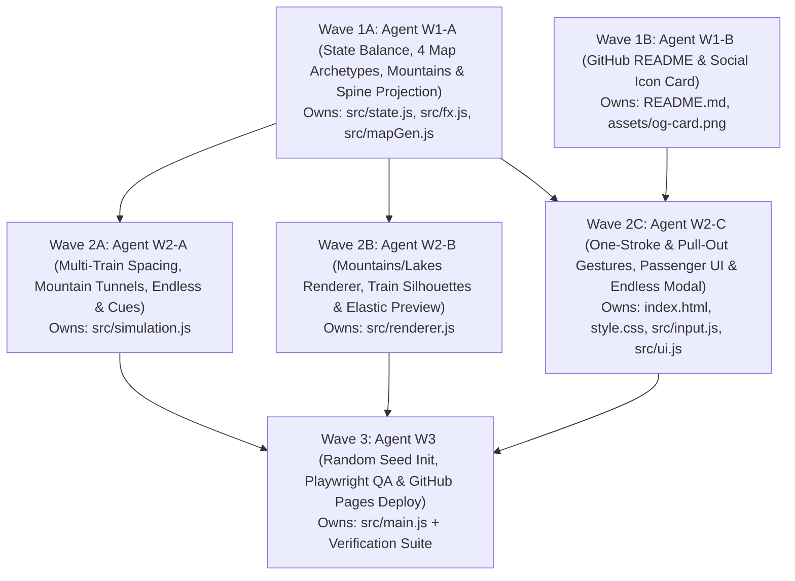

# Mini Rail v4 (Second Overhaul) — Hydrogen Multi-Agent Execution Plan

## 1. Mission & Overhaul Goals

Build directly on Mini Rail v3's beloved minimalist aesthetic to deliver richer geography, true Mini Metro single-stroke & pull-out line gestures, overlap-free multi-train line physics, crystal-clear Passenger vs. Freight visual identity, smoother difficulty pacing, and a flagship GitHub `README.md`:

1. **Richer Natural Geography, Mountains Requiring Tunnels & 4 Random Map Archetypes (#1 & #9)**:
   - Replace the hardcoded startup seed (`133742` in `src/main.js`) with a **fresh random seed every load** (supporting optional `?seed=` URL sharing and `"Retry Same Map"`).
   - Introduce **4 Procedural Map Archetypes** selected per seed:
     1. **`confluence`** — Y-fork river confluence splitting around a central peninsula.
     2. **`mountainPass`** — Central **Alpine Mountain Range** dividing two valleys with a narrow natural saddle pass.
     3. **`lakeBay`** — Broad organic central **Lake / Island Basin** fed by valley rivers.
     4. **`gorge`** — Dramatic S-bend canyon river flanked by alternating **Mountain Crags** and **Rolling Hills**.
   - Add **Mountains (`state.mountains`)** alongside upgraded organic multi-lobe **Hills (`state.hills`)**:
     - **Mountains**: Bold, multi-layered slate/stone polygons with crisp geometric summit ridgelines. Stations never spawn inside Mountains; tracks cutting through a Mountain **automatically consume `1 Tunnel` token** (reclaimed when removed, with live `TUNNEL -1` / `NO TUNNEL` drag preview pills—matching how Rivers auto-use `1 Bridge`).
     - **Rolling Hills**: Organic contoured foothills that trains can climb freely with a grade slowdown (or optionally upgrade with a manual Tunnel for full speed).
   - Randomize expansion station order & regional clustering per seed while guaranteeing balanced `Resource / Factory / Settlement` ratios.

2. **One-Stroke Continuous Line Creation & Elastic Pull-Out Shortening (#2 & #4)**:
   - **Continuous One-Stroke Sweep (#2)**: Holding left-click from a station or T-bar and sweeping across `A → B → C → D` **immediately connects each hop live during `pointermove`** (with a soft tactile chime), advancing the live drag anchor station-by-station in a single mouse movement—and sweeping back over the previous station immediately unwinds the last hop live.
   - **Pull-Out T-Bar Shortening (#4)**: Grabbing a line's T-bar at end station `C` (`A–B–C`) and pulling backward past `C` by `>= 34u` toward `B` **immediately pops `C` off the line live** (without having to drag all the way across the segment to `B`); releasing anywhere in empty space leaves the line cleanly shortened to `A–B`, or dragging onward to `D` reroutes to `A–B–D`.
   - **Pull Line Out of a Middle City to Bypass (#4)**: Dragging an active line's interior station `B` (`A–B–C`) outward `>= 28u` into empty paper previews the bypassed `A–C` rubber-band and, on release in empty space, cleanly unhooks `B` (`A–B–C → A–C`)!

3. **Distinct Minimalist Silhouettes for Passenger vs. Freight Trains (#3)**:
   - Preserve the clean v3 aesthetic while making train types unmistakable at any zoom:
     - **Passenger Train**: Streamlined **Bullet/Stadium Capsules (`25×10.8`, `rx = 5.4`)** in solid `lineColor` with a curved panoramic white windshield arc on the lead nose and `3` glowing circular passenger windows per coach.
     - **Freight Train**: Wider, squared-off **Dark-Framed Industrial Hoppers (`21×14.2`, `rx = 2.2`)** with a bold dark-steel outer chassis frame, `lineColor` heavy side-girders, a twin-hood industrial locomotive nose, and `3` visibly ribbed open cargo bays (clearly distinct even when empty, and holding chubby `raw`/`goods` icons when loaded).

4. **Zero-Confusion Supply Chain: `'Passenger'` Naming + Visual Frame Pairing + `'Needs Freight'` Cue (#7)**:
   - Rename player-facing `EXPRESS` labels/tooltips/badges to **`PASSENGER`** *(keeping internal code key `'express'` intact across state/simulation for zero contract churn)* so players never confuse "Express" with "Express Cargo".
   - Pair `Raw` and `Goods` cargo icons visually with Freight's **dark-steel industrial badge frame** (while Meeples match sleek rounded Passenger capsules) so it is visually self-evident that **Freight hauls all Cargo (`Forest/Mine → Factory → City/Town`)** and **Passenger hauls all People**.
   - Whenever a connected `Resource` or `Factory` station has waiting output/input but **zero Freight trains** serve any line touching it, display a subtle pulsing **mini Freight Hopper cue** (`Needs Freight Train` on hover).

5. **Overlap-Free Multi-Train Spacing & Side-by-Side Station Passing (#6)**:
   - **Root causes fixed**:
     - Replace hardcoded `SAFE_GAP: 36` (which was shorter than a `68u` 3-car consist!) with dynamic **`minSpineGap(trA, trB) = (fullLen(trA) + fullLen(trB)) * 0.5 + 22`** enforced continuously along `line.spine`—including across stations so trailing same-direction trains brake smoothly *outside* an occupied station instead of stacking on top of a dwelling train.
     - Stop resetting `tr.lateralOffset = 0` instantaneously upon station arrival; instead, smoothly interpolate `tr.lateralOffset` in consistent **world spine-normal coordinates** (`+5.0u` for `direction === +1`, `-5.0u` for `direction === -1`) through `2×` Double-Track corridors and whenever opposing trains pass/meet side-by-side at station platforms.
     - When dropping a train onto a track at `(wx, wy)`, project onto `line.spine` to place it right under the cursor and auto-pick the direction/station offset that maximizes spacing from existing trains on that line.

6. **Gentler Difficulty Scaling + `'Continue in Endless'` (#5)**:
   - Slow station spawns from `18s` (~4/week) to **`34s` initial (`~2/week`)**, tapering gently (`Math.max(23, 36 - week * 1.15)`), with a `6.5s` grace warmup on newly spawned stations.
   - Relax base demand intervals from `7.0–8.6s` to **`10.2–11.8s`** and cut weekly demand acceleration nearly in half (`+8.5%/week` instead of `+16%/week`).
   - Increase `OVERFLOW_DURATION` from `30s` to **`42s`** with faster recovery (`1.25×` drain), and start players with **`2 Bridges + 2 Tunnels`** so river + mountain maps have fair Week 1 flexibility.
   - Add a **`Continue in Endless`** button on the Game Over modal (`state.endlessMode = true`, clearing overflow timers and letting players continue building their railway forever without overcrowding game-overs).

7. **Polished GitHub `README.md` + Game Icon Showcase (#8)**:
   - Create root `README.md` featuring the centered **Transit Junction game icon (`assets/favicon.svg`)**, live **Play Now** badge (`https://piezoperny.github.io/minirail/`), visual Passenger vs. Freight & Supply-Chain guide, Mini Metro gesture controls table, and OpenGraph social icon metadata (`assets/og-card.png`).

### Tech & Deployment Constraints
- **Zero external runtime dependencies & zero build step**: Vanilla HTML5 Canvas, CSS3, static SVG/PNG assets, and ES6 modules (`index.html`, `style.css`, `src/*.js`).
- **Git & Hosting Policy**: Commit & push directly to `main` on `https://github.com/piezoperny/minirail` (do **not** open pull requests unless explicitly requested). Pushing to `main` deploys automatically to `https://piezoperny.github.io/minirail/`.

---

## 2. Parallel Execution Topology & Strict File Ownership

Execution is organized into **3 Dependency Waves** with strict single-owner file boundaries so concurrent agents never collide:

| Wave | Agent Role | Exclusive Write Files | Read Dependencies |
| :--- | :--- | :--- | :--- |
| **Wave 1** | **W1-A: Geography, Balance & Spine Contracts** | `src/state.js`, `src/fx.js`, `src/mapGen.js` | Existing `state.js`, `fx.js`, `mapGen.js` |
| **Wave 1** | **W1-B: Documentation & Brand Showcase** | `README.md`, `assets/og-card.png` | `assets/favicon.svg`, `src/state.js` |
| **Wave 2** | **W2-A: Traffic, Mountain Tunnel & Pacing Sim** | `src/simulation.js` | Wave 1 `src/state.js`, `src/fx.js`, `src/mapGen.js` |
| **Wave 2** | **W2-B: Terrain, Fleet & Gesture Renderer** | `src/renderer.js` | Wave 1 `src/state.js`, `src/fx.js`, `src/mapGen.js` |
| **Wave 2** | **W2-C: Elastic Input, Passenger HUD & Endless UI** | `index.html`, `style.css`, `src/input.js`, `src/ui.js` | Wave 1 modules + `assets/og-card.png` + locked `simulation.js` exports |
| **Wave 3** | **W3: Integrator, QA & Pages Deployment** | `src/main.js` *(+ integration polish if needed)* | All repository files |

---

## 3. Shared Data & Function Contracts (Locked in Wave 1)

All Wave 2 agents MUST code against these exact exports and schemas.

### 3.1 Internal Key Stability Rule (`'express'` vs `'PASSENGER'`)
- Keep internal data keys **`'express'`** and **`'freight'`** unchanged in `state.inventory.express`, `train.type`, `token.service`, and `data-tool="express"`.
- Update **all player-facing UI strings** (dock label, tooltips, weekly reward prompt/labels, drag pill `'PAX'`, floating toast `'Passenger Dispatched!'`, Field Manual) to **`PASSENGER`**.

### 3.2 `CONFIG`, Palettes & State Schema Updates (`src/state.js`)
- **Rebalanced Pacing & Spacing Constants (`CONFIG`)**:
  - `INITIAL_SPAWN_INTERVAL: 34.0`
  - `OVERFLOW_DURATION: 42.0`, `OVERFLOW_DRAIN_RATE: 1.25`
  - `PASSENGER_UNIT_LEN: 25`, `FREIGHT_UNIT_LEN: 21`, `HEADWAY_BUFFER: 22`
  - `PLATFORM_PASS_OFFSET: 5.0`
  - Starter `inventory`: `{ express: 1, freight: 1, car: 1, bridge: 2, doubleTrack: 1, tunnel: 2, interchange: 0 }`
  - Expand `SETTLEMENT_NAMES` to `18+` regional names and `INDUSTRY_NAMES` (`forest`, `mine`, `factory`) to `6+` names each for richer variety across `24` expansion spawns.
- **Theme Additions (`THEMES.day` & `THEMES.night`)**:
  - `THEMES.day`: add `mountainOuter: 'rgba(120, 113, 108, 0.22)'`, `mountainInner: 'rgba(100, 94, 88, 0.32)'`, `mountainPeak: 'rgba(87, 83, 78, 0.44)'`, `mountainRidge: 'rgba(68, 64, 60, 0.62)'`, `freightFrame: '#1E293B'`
  - `THEMES.night`: add `mountainOuter: 'rgba(148, 163, 184, 0.08)'`, `mountainInner: 'rgba(148, 163, 184, 0.14)'`, `mountainPeak: 'rgba(203, 213, 225, 0.20)'`, `mountainRidge: 'rgba(226, 232, 240, 0.38)'`, `freightFrame: '#0F172A'`
- **State Fields (`createInitialState`)**:
  - `endlessMode: false`
  - `mapArchetype: 'confluence'` (`'confluence' | 'mountainPass' | 'lakeBay' | 'gorge'`)
  - `rivers: []` (`Array<{ points, halfWidth }>`, with `state.river` pointing to `rivers[0]` for compatibility)
  - `lakes: []` (`Array<{ id, x, y, rx, ry, points, haloPoints }>`)
  - `mountains: []` (`Array<{ id, x, y, rx, ry, angle, outerPoly, innerPoly, peakPoly, ridgeLine }>`)
  - `hills: []` (`Array<{ id, x, y, rx, ry, angle, ringsPoly: Array<Array<{x, y}>> }>`)
  - `nextSpawnInterval: CONFIG.INITIAL_SPAWN_INTERVAL` (`34`)
  - Station fields: add `needsFreightCue: false`
  - Corridor fields (in `simulation.js`): add `mountainCrossings: 0`, `mountainIntervals: []`, `hasMountainTunnel: false`
  - Interaction modes: `'idle' | 'buildLine' | 'detachStation' | 'insertNode' | 'dragToken' | 'dragTrain' | 'dragUpgrade' | 'pan'`

### 3.3 Geography, Multi-Water, Mountains & Spine Projection (`src/mapGen.js`)
Keep all existing exported function names intact and upgrade/add:
1. **Unified Water & Mountain Geometry Helpers**:
   - Accept either `state.river` OR a water collection (`{ rivers, lakes }` / `state`) in `distanceToRiver(water, px, py)`, `countRiverCrossings(points, water)`, and `computeRiverIntervals(points, cumLengths, totalLength, water)` so tributary rivers and lakes automatically require Bridges and render water-only bridge decks!
   - Export `isPointInPolygon(poly, px, py)` and `isPointInMountain(mountains, px, py)`.
   - Export `countMountainCrossings(points, mountains)` and `computeMountainIntervals(points, cumLengths, totalLength, mountains)` (returning merged `[{ start, end }]` spans across `mountain.outerPoly`, clamped away from station centers).
2. **Context-Aware `buildOctilinearPoints(ax, ay, bx, by, water, hills, context = null)`**:
   - Reads `const mountains = context?.mountains || []`.
   - Scores candidates with `riverCrossings * 10000 + mountainCrossings * 9500 + hillLen * 1.0` plus existing station-clearance & junction-continuity penalties, so tracks naturally skirt mountain flanks when possible and bore cleanly through when connecting across a range.
3. **4 Map Archetypes & Organic Terrain (`generateWorld(state)`)**:
   - Pick `state.mapArchetype` from `['confluence', 'mountainPass', 'lakeBay', 'gorge']` via `state.rng()`.
   - Generate `state.rivers`, `state.lakes`, `state.mountains` (`1–3` sculpted polygonal massifs with `outerPoly`, `innerPoly`, `peakPoly`, and angular `ridgeLine`), and `state.hills` (`3–5` organic harmonic-perturbed contour ring polygons `ringsPoly`).
   - Ensure `canPlace` excludes water (`rivers` & `lakes` + bank buffer) AND excludes `isPointInMountain(state.mountains, x, y)` (+ `22u` buffer).
   - Guarantee starter Express line (`s1 ↔ s2`) crosses `0` rivers and `0` mountains, while starter valley showcases nearby water/mountain/hill landmarks clearly.
   - Generate a **randomized 22-node expansion schedule** per seed (shuffling within balanced `4–5` node waves so players always get timely Resources, Factories, Hamlets, and `2` mid/late Cities).
4. **Spine Projection Helper**:
   - Export `projectPointOntoSpine(spine, wx, wy)` → `{ u, x, y, dist, legIndex }` finding the closest arc coordinate `u` along `spine` (used for cursor-exact train placement!).
   - Update `computeTrainUnitPoses(spine, consistStartU, unitCount, direction, lateralOffset = 0)` so `lateralOffset` is ALWAYS applied along the **consistent world spine normal** (`nx, ny` of increasing `u`, independent of `direction`), guaranteeing `+5u` and `-5u` sit on opposite sides of the track!

### 3.4 New / Updated Simulation Exports (`src/simulation.js`)
Keep all existing exports and add:
- `getConsistLength(train)` → `(train.cars ?? CONFIG.TRAIN_DEFAULT_CARS) * CONFIG.CAR_SPACING + (train.type === 'freight' ? CONFIG.FREIGHT_UNIT_LEN : CONFIG.PASSENGER_UNIT_LEN)`.
- `deployTrainAtWorldPos(state, type, lineId, wx, wy)` — projects `(wx, wy)` onto `line.spine`, places the train at the nearest valid spine/station spot, and auto-chooses `direction` (`+1` or `-1`) to maximize distance/opposite flow relative to existing trains on `lineId`.
- `moveTrainToWorldPos(state, trainId, lineId, wx, wy)` — same smart cursor-projected placement when dragging an active train onto a line.
- `replaceStationInLine(state, lineId, oldStationId, newStationId)` — cleanly reroutes `A–old–C → A–new–C` when dragging an interior station onto another station!
- `continueEndlessMode(state)` — sets `state.endlessMode = true`, clears `overflowTimer` & `warningPulseTimer` on all stations, sets `state.phase = 'playing'`, `state.speed = Math.max(1, state.savedSpeedBeforeModal || 1)`.
- Update `canAddCorridorForLine(state, id1, id2)` & `activateCorridorForLine` to check and auto-consume/release **both** `bridge` (when `riverCrossings > 0`) and `tunnel` (when `mountainCrossings > 0` via `corridor.hasMountainTunnel = true; corridor.hasTunnel = true`), returning `{ ok: false, reason: 'No Tunnels left!' }` when blocked by a mountain without tunnels!

---

## 4. Detailed Wave Specifications

### Wave 1A — Agent W1-A (`src/state.js`, `src/fx.js`, `src/mapGen.js`)
1. Update `src/state.js` with all Section 3.2 constants, palettes, expanded name pools, and state fields (`endlessMode`, `mapArchetype`, `rivers`, `lakes`, `mountains`).
2. Keep `src/fx.js` clean (supporting subtle pulse animations for `needsFreightCue` phase if needed).
3. Upgrade `src/mapGen.js` with all Section 3.3 capabilities (`rivers` + `lakes` water helpers, polygonal `mountains` + `computeMountainIntervals`, harmonic multi-ring `hills`, 4 random map archetypes, randomized balanced expansion waves, `projectPointOntoSpine`, and consistent spine-normal `lateralOffset` in `computeTrainUnitPoses`).
4. Gate check: `node --check src/state.js && node --check src/fx.js && node --check src/mapGen.js`.

### Wave 1B — Agent W1-B (`README.md`, `assets/og-card.png`)
1. Generate `assets/og-card.png` (`1200×630` crisp social preview banner in `#161A22` dark slate featuring the vector Transit Junction emblem, **MINI RAIL** title, and minimalist colored octilinear lines).
2. Write a clean, visual, scannable root `README.md`:
   - Top-centered ``, title, one-line pitch, and **Play Live** button/badge (`https://piezoperny.github.io/minirail/`).
   - **Train & Supply-Chain Guide**: Clear breakdown of **Passenger Bullet Trains** (Hamlets ↔ Towns ↔ Cities) vs. **Heavy Freight Hoppers** (`Forest/Mine → Factory → Growing Settlements`), plus **Rivers (Bridges)** & **Mountains (Tunnels)**.
   - **Mini Metro Controls & Gestures Table**: One-stroke sweep building, pull-back T-bar shortening, pull-out middle-city unhooking, cursor zoom/pan, line spotlighting, Day/Night mode (`N`).
   - Architecture & zero-build local run instructions (`python3 -m http.server`).

---

### Wave 2A — Agent W2-A (`src/simulation.js`)
1. **Mountain Auto-Tunnels & Multi-Water Corridors**:
   - Pass `{ stations: state.stations, mountains: state.mountains }` and `{ rivers: state.rivers, lakes: state.lakes }` into `buildOctilinearPoints`, `countRiverCrossings`, `computeRiverIntervals`, `countMountainCrossings`, and `computeMountainIntervals`.
   - Enforce `tunnel` inventory check & auto-consume/reclaim `hasMountainTunnel` symmetrically with `hasBridge`.
2. **Overlap-Free Multi-Train Spine Kinematics (`stepTrains` — #6)**:
   - Maintain `tr.spineU` continuously for every train (`atStation`, `waitingBlock`, and `traversing`).
   - Compute `minGap = (getConsistLength(tr) + getConsistLength(other)) * 0.5 + CONFIG.HEADWAY_BUFFER` along `line.spine` against **all** same-line, same-direction trains ahead (including trains currently `atStation` or `waitingBlock` at upcoming stations!), unless `tr.lane === 1` during a `isDoubleTrack` overtake.
   - Before transitioning `tr` into `atStation` upon reaching `tr.s >= total`, check if another same-direction train on `lineId` is already occupying that station (`Math.abs(other.spineU - stationU) < minGap * 0.85`); if occupied, hold `tr` smoothly just outside the station (`tr.s = Math.max(0, total - minGap)`) until the platform clears!
   - **Smooth Side-by-Side Passing (`lateralOffset`)**:
     - Never reset `tr.lateralOffset = 0` on station arrival!
     - Set `targetLateral = tr.direction * CONFIG.PLATFORM_PASS_OFFSET` (`±5.0u`) whenever:
       - `corridor?.isDoubleTrack` (using `-tr.direction * CONFIG.OVERTAKE_OFFSET` when overtaking on `lane === 1`), OR
       - An opposing train (`other.lineId === tr.lineId && other.direction !== tr.direction`) is within `130u` along `line.spine` (e.g. meeting/passing at a station platform!).
     - Smoothly damp `tr.lateralOffset += (targetLateral - tr.lateralOffset) * Math.min(1, simDt * 8.0)` every frame.
   - Implement `deployTrainAtWorldPos`, `moveTrainToWorldPos`, and `replaceStationInLine`.
3. **Supply-Chain `'Needs Freight'` Cue & Pacing / Endless Mode (#5 & #7)**:
   - Update `st.needsFreightCue` each step for connected `resource` / `factory` stations that have waiting `raw`/`goods`/`inputBuffer` but zero `freight` trains on any line serving `st.id`.
   - Apply the gentler spawn & demand timers (`34s` initial spawn interval, `6.5s` new-station spawn grace, `10.2–11.8s` base demand, `+8.5%/week` ramp, `42s` overflow duration, `1.25×` drain) and skip game-over trigger when `state.endlessMode === true`.
   - Implement `continueEndlessMode(state)`.
4. Gate check: `node --check src/simulation.js`.

---

### Wave 2B — Agent W2-B (`src/renderer.js`)
1. **Upgraded Natural Map Rendering (`drawLakes`, `drawRivers`, `drawHills`, `drawMountains` — #1 & #9)**:
   - Render `state.lakes` and all rivers in `state.rivers` with seamless bank halos + flat water fill (merging cleanly at confluences and lake mouths).
   - Render `state.hills` using their organic multi-lobe `ringsPoly` contours.
   - Render `state.mountains` as striking minimalist **Alpine Massifs**: layered stone polygons (`outerPoly`, `innerPoly`, `peakPoly`) topped with a crisp geometric ridgeline spine (`ridgeLine`) + subtle facet shading so players immediately recognize "Mountain = Needs Tunnel!".
   - Render tunnel portal sleeves across **both** `corridor.mountainIntervals` and (when manually tunneled) `corridor.hillIntervals`, with crisp stone portal caps `[` `]` at tunnel entrances!
2. **Passenger Bullet Capsules vs. Dark-Framed Freight Hoppers (#3 & #7)**:
   - **`drawExpressUnit` (Passenger)**: `25 × 10.8` stadium pill (`rx = 5.4`) in `lineColor` with `pal.stationFill` border; lead unit features a curved panoramic white windshield arc at the nose; trailing coaches show `3` crisp circular passenger windows.
   - **`drawFreightUnit` (Freight)**: `21 × 14.2` squared hopper (`rx = 2.2`) with bold `pal.freightFrame` (`#1E293B` / `#0F172A`) structural chassis, thick `lineColor` side-girders along both flanks, twin-hood diesel cab/chevrons on the lead locomotive, and `3` recessed cargo compartments separated by `2` dark cross-ribs (holding miniature `raw`/`goods` icons when loaded).
   - **Cargo Icon Frame Pairing & `'Needs Freight'` Cue (#7)**:
     - Give `raw` and `goods` token icons a crisp `pal.freightFrame` industrial outline accent matching Freight cars.
     - When `st.needsFreightCue` is true, draw a subtle bobbing/pulsing mini Freight Hopper badge above `st` (and append `· Needs Freight Train` in `drawHoverLabel`).
3. **Drag Preview Upgrades (`TUNNEL -1` & Elastic Detach Rubber-Band)**:
   - Update `drawDragPreview` in `buildLine` / `insertNode` to check both `riverCrossings` (`BRIDGE -1` / `NO BRIDGE`) and `mountainCrossings` (`TUNNEL -1` / `NO TUNNEL`).
   - When `state.interaction.mode === 'detachStation'`, render a clean dashed rubber-band preview showing either the bypassed `prevSt ↔ nextSt` connection (when cursor is in empty space) or `prevSt → snapSt → nextSt` (when hovering a replacement station)!
4. Gate check: `node --check src/renderer.js`.

---

### Wave 2C — Agent W2-C (`index.html`, `style.css`, `src/input.js`, `src/ui.js`)
1. **One-Stroke Sweep & Elastic Pull-Out Line Gestures (`src/input.js` — #2 & #4)**:
   - **Continuous One-Stroke Sweep (`mode === 'buildLine'`)**:
     - During `pointermove`, whenever cursor enters `hitTestStation(state, x, y, 25)` on `snapSt` (`snapSt.id !== drag.fromStationId`):
       - If `snapSt.id` is the immediate neighbor behind `drag.fromStationId` on `line`, call `trimLineEnd(state, drag.lineId, drag.endSide)` live and step `drag.fromStationId = snapSt.id`!
       - Else call `extendOrStartLine(state, drag.lineId, drag.fromStationId, snapSt.id)` live! On `res.ok`, advance `drag.fromStationId = snapSt.id`, update `drag.endSide`, trigger `callbacks.onLineStep?.()` + `callbacks.onNetworkChanged?.()` (and end drag cleanly if `line.isLoop` closed).
   - **Pull-Out T-Bar Shortening (`>= 34u` backward pull)**:
     - In `buildLine` when `drag.fromStationId` is an endpoint `E` (`start` or `end`) of a non-loop line with adjacent station `Prev`:
       - Compute backward projection `backDist` of `(x - E.x, y - E.y)` along unit vector `(Prev - E) / |Prev - E|`.
       - When `backDist >= 34` (cursor pulled back past `E` out of the city!), immediately call `trimLineEnd(state, drag.lineId, drag.endSide)`:
         - If `line.stations.length >= 2`, `drag.fromStationId` becomes `Prev.id` (still in live `buildLine` so releasing anywhere in empty space leaves it shortened at `Prev`, or sweeping to `D` connects `Prev → D`!).
         - If `line.stations.length === 0` (a 2-station line was popped down to 0!), end drag cleanly (`mode = 'idle'`) so releasing leaves the line removed!
   - **Pull Interior Station Out to Unhook (`mode === 'detachStation'`)**:
     - On `pointerdown` on station `st`: if `st` is an **interior** station on `activeLine` (or on an existing line when no empty line is currently selected in `#dock-lines`), start `mode = 'detachStation'` with `{ lineId, stationId: st.id, prevId, nextId, detached: false }`.
     - Once dragged `>= 28u` away from `st`, set `drag.detached = true` (showing live bypass preview). On `pointerup`: if `drag.detached` and `!drag.snapStationId`, call `removeStationFromLine(state, lineId, st.id)`; if `drag.snapStationId`, call `replaceStationInLine(state, lineId, st.id, drag.snapStationId)`.
   - **Cursor-Exact Train Drop**: Use `deployTrainAtWorldPos` and `moveTrainToWorldPos` when dropping trains onto corridors/stations.
2. **Passenger Naming, Updated Consist SVGs, Endless Button & OpenGraph (`index.html`, `style.css`, `src/ui.js` — #3, #5, #7, #8)**:
   - Add OpenGraph / Twitter meta tags in `index.html` (`og:title`, `og:description`, `og:image` → `https://piezoperny.github.io/minirail/assets/og-card.png`).
   - Rename `EXPRESS` dock label & weekly reward label to **`PASSENGER`**, and update the `PASSENGER` (sleek bullet capsule) and `FREIGHT` (dark-framed ribbed hopper) inline SVGs in both `#bottom-dock` and `openDraftModal()`.
   - Add a **New Map (`↻`)** or seed display in Help + **`Continue in Endless`** button (`#btn-continue-endless`) on `#gameover-modal` wired to `continueEndlessMode(state)`, plus an `ENDLESS` pill indicator in `#top-hud` when `state.endlessMode` is active.
   - Update Field Manual (`#help-modal`) to concisely explain **Passenger** vs. **Freight** supply chains, **Mountains (Tunnels)**, and **One-Stroke / Pull-Out** gestures.
3. Gate check: `node --check src/input.js && node --check src/ui.js`.

---

### Wave 3 — Agent W3 (`src/main.js` + End-to-End Playwright QA & GitHub Pages Deploy)
1. **Random Seed Startup & `?seed=` URL Parameter (`src/main.js`)**:
   - Parse `?seed=` from `window.location.search`; if valid integer, use it, otherwise generate a fresh random seed (`Math.floor(Math.random() * 0xffffffff)`) on initial page load!
2. **Automated Syntax, Physics & Visual QA Suite**:
   - Run `for f in src/*.js; do node --check "$f"; done`.
   - Run headless Playwright tests verifying:
     1. **Map Variety & Mountains (#1 & #9)**: Reloading twice without `?seed=` yields distinct seeds/layouts; generating across seeds exercises all 4 `mapArchetype` values (`confluence`, `mountainPass`, `lakeBay`, `gorge`), populates `state.mountains`, and crossing a mountain consumes `1` `tunnel` (reclaimed on removal).
     2. **One-Stroke Sweep & Pull-Out Shortening (#2 & #4)**: Single `pointerdown → pointermove(A → B → C) → pointerup` connects `[A, B, C]` in one drag; pulling `C`'s T-bar `40u` back toward `B` and releasing in empty space shortens to `[A, B]`; pulling interior `B` out of `[A, B, C]` into empty space yields `[A, C]`.
     3. **Multi-Train Anti-Overlap & Passing (#6)**: Deploy 3 trains on the same line and step `1200` frames—assert no two same-direction trains ever come closer than `minSpineGap * 0.85` (zero station stacking!) and opposing trains pass at stations with opposite-sign `lateralOffset` and zero deadlocks.
     4. **Pacing, `'Passenger'` Clarity & Endless Mode (#5, #7, #8)**: Verify `PASSENGER` UI labels, `needsFreightCue` activation on unserved connected Factory, `34s` initial spawn interval, `#btn-continue-endless` resuming play in `endlessMode === true`, and `README.md` + `assets/og-card.png` present.
     5. **High-DPI Visual Inspection**: Capture `1440×900 @ 2x` screenshots showcasing Mountains + Lakes/Confluences, Bullet Passenger vs. Industrial Hopper trains passing cleanly on a busy line, and Day/Night themes—confirming zero visual overlaps or console/page errors.
3. **Direct Deployment to GitHub (`main` → GitHub Pages)**:
   - Commit & push directly to `main`, poll `gh api repos/piezoperny/minirail/pages --jq .status` until `"built"`, and verify `https://piezoperny.github.io/minirail/` live.
